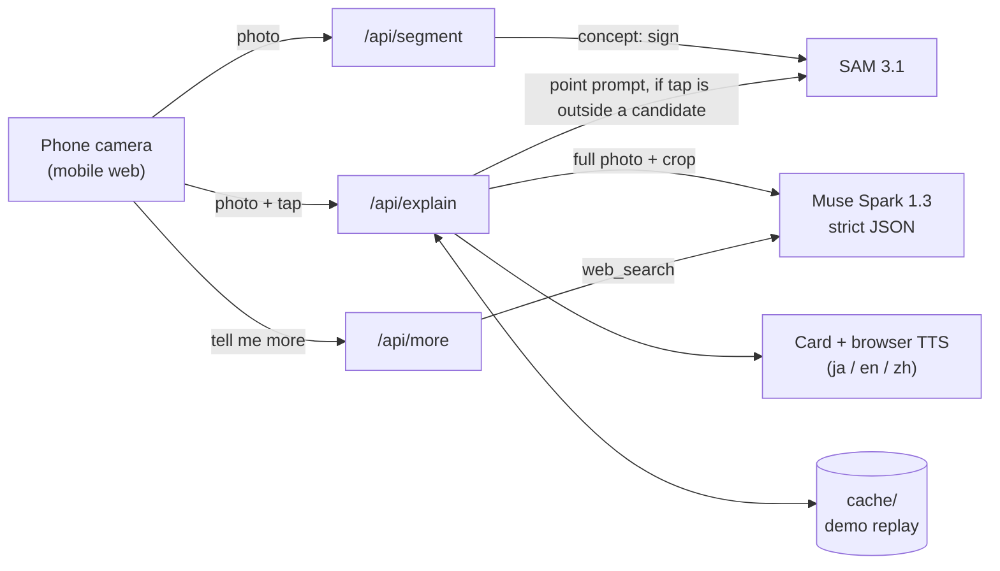

# Nunchi (눈치) · 찍으면 들리는 한국

_Nunchi_ (눈치) is the Korean knack for reading a situation without being told.

Point your phone at a Korean sign, menu or notice, tap the text, and hear in your own language
what it says, **why it is there**, and **what you should do now**, plus a link to your native language
(e.g. 일방통행 = 一方通行 for Japanese travellers).

Translation apps change the letters. Nunchi explains the place.

It is a mobile web app (PWA): open the URL in the phone browser, no install needed.

**Demo video:** _coming soon_

## Built during the hackathon
Everything in this repository was written during the Meta Global AI Developer Hackathon building period
(Oct 27 – Nov 4, 2026); there is no earlier codebase. See the git history. That covers:
- the tap-to-region pipeline (SAM 3.1 concept candidates, point prompt, fallback rules),
- the prompts and the strict 10-field JSON schema for Muse Spark 1.3, including the native-language bridge rules,
- "Tell me more" with web search and sources,
- the mobile web app (camera, candidate boxes, narration, demo mode, PWA),
- the cache, rate limit, spend ledger and budget guard, and the test/regression scripts.

## Why
A translation of 「휴지통 없는 화장실」 tells you "restroom without a trash can". It does not tell you that the
paper goes in the toilet, or why. Travellers standing in front of a sign need the reason and the next action,
in their own language, read aloud while their hands are busy.

## How it works
1. **Tap.** When a photo is uploaded, **SAM 3.1** finds sign candidates (concept prompt `sign`) and draws them.
   A tap inside a candidate uses that box; otherwise SAM 3.1 segments the tapped point (point prompt).
2. **Explain.** **Muse Spark 1.3** reads the full photo plus the tapped crop and returns strict JSON:
   reading, meaning, why it is here, what to do, a native-language bridge, a 20–30 s narration and a confidence.
3. **Listen.** The browser reads the narration aloud (Web Speech API) and can play the Korean original.
   "Tell me more" asks Muse Spark again with **web search** for 2–3 grounded sentences and source links.



## Meta models used
| Model | Used for |
|---|---|
| `sam-3.1` | sign candidates (concept prompt) and the tapped region (point prompt) |
| `muse-spark-1.3` | strict-JSON explanation (`reasoning_effort=minimal`), and "Tell me more" via the Responses API with `web_search` |

Muse Voice Transcribe is not used yet (see Limits). Meta's API has no text-to-speech, so speech uses the browser.

## Run
```bash
uv venv --python 3.12 .venv && uv pip install -r requirements.txt   # or: python -m venv .venv && pip install -r requirements.txt
cp .env.example .env                 # put your dev.meta.ai key in MODEL_API_KEY
.venv/bin/python -m scripts.smoke_test test-images/01_road_oneway.jpg   # 1) verify API access
.venv/bin/python -m scripts.warm_cache ja en                             # 2) pre-fill demo results + regression check
.venv/bin/uvicorn backend.app:app --host 0.0.0.0 --port 8000             # 3) open http://localhost:8000
```
- `http://localhost:8000/?demo=1` — demo mode: a grid of test photos; taps snap to preset points so cached results replay instantly, even offline.
- `?lang=ja|en|zh` picks the language from the URL.

### On a phone (HTTPS is required for the camera)
```bash
cloudflared tunnel --url http://localhost:8000     # prints https://<random>.trycloudflare.com
```
Open the printed URL in iPhone Safari. Narration uses the device voices (best on iOS/macOS: Kyoko / O-ren for Japanese, Samantha for English, Yuna for Korean).

### Tuning (env vars)
| var | default | meaning |
|---|---|---|
| `SPARK_EFFORT` | `minimal` | Muse Spark `reasoning_effort` |
| `MAX_SIDE` | `1280` | longest image side sent to the models |
| `SEND_FULL` | `1` | send full photo + tapped crop (`0` = crop only) |
| `HEDGE_S` / `REQUEST_TIMEOUT_S` | `9` / `20` | duplicate a slow Spark request after 9 s; give up after 20 s |
| `APP_NAME` / `APP_NAME_KO` | `Nunchi` / `눈치` | app name shown in the UI |
| `LIVE` | `1` | `0` = serve cached results only (safe public demo link) |
| `RATE_PER_MIN` | `20` | live model calls per client IP per minute |
| `BUDGET_USD` | `50` | stop live calls when estimated spend reaches this |

### Scripts
- `scripts/latency_test.py` — compares effort / image size / crop-only settings.
- `scripts/batch_test.py test-images ja en` — whole-photo explanation for every image → `report.html` for human review + keyword check against `scripts/expectations.json`.
- `scripts/warm_cache.py` — fills `cache/` for every demo photo × preset tap × language (and its "Tell me more") through the real endpoints and checks `korean_text` against `scripts/expectations.json`.
- `scripts/webkit_check.py` — demo flow in Playwright WebKit with iPhone 13 emulation (cache only, no cost; needs `playwright install webkit`).
- `scripts/demo_video/build.sh` — rebuilds the demo video from the running app (cached results only).
- `scripts/usage_report.py` — estimated Meta API spend from `usage/usage.jsonl`; live calls stop at `BUDGET_USD` (default 50).

## How a tap is resolved
1. On upload, `/api/segment` asks SAM 3.1 for the concept `sign`; candidates are drawn faintly.
2. A tap inside a candidate uses that box directly (no extra SAM call).
3. Otherwise SAM 3.1 gets a point prompt. If it returns nothing, a box under 2% of the image, or confidence < 0.4,
   a fixed square around the tap (35% of the short side) is used instead.
4. A box covering more than 80% of the photo is not cropped: Muse Spark just gets the photo.

## Notes
- Muse Wonder is not available in South Korea, so everything runs on Muse Spark 1.3.
- Meta Model API has no text-to-speech; speech uses the browser.
- `reasoning_effort=minimal` cut Muse Spark latency from ~14 s to ~8 s with no visible quality loss on the test set; `low` regularly hit 15 s.
- SAM 3.1 point prompts on small signs often return a tiny fragment with low confidence (e.g. conf 0.23), hence the fallback rules above.
- SAM 3.1 concept prompts take one noun phrase per request: `sign` works, `sign, text` returns nothing.
- Results are cached in `cache/` so the demo replays even if the network drops. Uploaded photos are never stored; logs keep only timing.
- Test photos: openly licensed, see `test-images/sources.csv` for authors and licenses. Photo 12 is excluded (license unconfirmed).

## Limits and next steps
- Speech quality depends on the device's voices; iOS/macOS voices sound best.
- Small or stylised text can be misread; when unsure the model says so (`confidence: low`).
- Next: voice follow-up questions with `muse-voice-transcribe-1.0`, polished Chinese UI, offline caching as a PWA.

## License
Code: MIT (see `LICENSE`). Test photos: each under its own license, listed in `test-images/sources.csv`;
CC BY-SA photos (04, 06, 11, 13, 16, 18) are shared under the same license.
